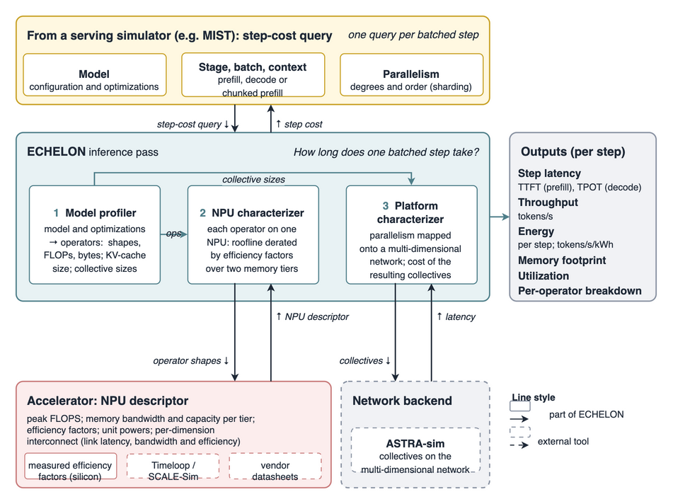

# ECHELON (GenZ)

**ECHELON** (**E**valuation of **C**ompute, **H**ardware & int**E**rconnect for
**L**LM serving optimizati**ON**s) is an analytical framework that models one
batched LLM inference step on a distributed platform. It covers model
architectures, serving optimizations, parallelism strategies and hardware. It is
the artifact for the ICCAD 2026 paper *"Analyzing the impact of emerging
technology on AI Datacenter serving distributed LLM inference using ECHELON."*

> **Naming.** The framework was first released as **GenZ**. The repository
> (`GenZ-LLM-Analyzer`), the Python package (`genz_llm`) and the import name
> (`GenZ`) keep the old name; the paper calls it ECHELON.

  - [Overview](#overview)
  - [Installation](#installation)
  - [Examples](#examples)
  - [Parallelism and communication](#parallelism-and-communication)
  - [Data types](#data-types)
  - [Use with MIST](#use-with-mist)
  - [TODOs](#todos)
  - [Citation](#citation)

## Overview

ECHELON answers *"how long does one batched step take?"* for a given model,
serving stage, batch, context length, parallelism and hardware. It returns step
latency (TTFT for prefill, TPOT for decode), throughput, energy, memory
footprint, utilization and a per-operator breakdown, in about 30 ms per query.

<p align="center"></p>

ECHELON has three components:

1. **Model profiler.** Reads the HuggingFace config and turns the model and its
   optimizations into operators: shapes, FLOPs, bytes, KV-cache size and
   collective sizes. Supports MHA/MQA/GQA/MLA attention, dense, GLU, MoE and
   Mamba models, and optimizations such as FlashAttention, quantization,
   chunked prefill and speculative decoding.
2. **NPU characterizer.** Costs each operator on one NPU with a roofline,
   derated by efficiency factors for compute (`Eff_C`) and for two memory tiers
   (fast HBM/DDR and slow offload memory such as CPU DRAM or CXL):

   `T_op = max(C_op / (FLOPS × Eff_C), M_op / (BW_mem × Eff_mem))`

   For existing hardware, efficiency factors come from measured runtimes. For
   hypothetical NPUs, they come from microarchitecture simulators such as
   Timeloop or SCALE-Sim.
3. **Platform characterizer.** Maps TP, EP, PP and SP onto a multi-dimensional
   interconnect (each dimension has link latency, bandwidth and efficiency) and
   costs the resulting collectives, analytically or through
   [ASTRA-sim](https://github.com/astra-sim/astra-sim).

### Validation

Against real hardware (NVIDIA A100/H100, Intel Gaudi2, AMD MI300X and
SambaNova SN40L), ECHELON's geomean error is at most 5.8%. Prefill and decode
error on NVIDIA platforms is below 3%, and chunked-prefill end-to-end error is
below 2%. Platform rankings stay the same when the efficiency factors are
perturbed by ±30%.

### What ECHELON has been used for

- **Hardware requirement analysis.** How TFLOPS, memory bandwidth, interconnect
  bandwidth and link latency each affect prefill, decode and chunked latency.
- **Cross-technology comparison.** Four compute architectures (multi-GPU, SRAM
  wafer, multi-SRAM-chip, Transformer ASIC) and four interconnect
  configurations. No architecture wins everywhere: SRAM wafer-scale engines lead
  for long-context and reasoning workloads, GPUs and ASICs for decode-heavy
  interactive use, and optically augmented scale-out fabrics are the most
  balanced for large models.
- **Heterogeneous speculative decoding.** Drafting on SRAM chips while GPUs
  verify improves interactivity and GPU utilization over homogeneous
  deployments.
- **Platform requirements for LLM use cases** (arXiv 2024, the original GenZ
  paper).

## Installation

```sh
pip install genz-llm
```

The PyPI release lags behind this repository. To build from source (this repo
includes the `aiconfigurator` submodule, used for the ASTRA-sim backend):

```sh
# 1. Install Git LFS (required by the aiconfigurator submodule)
git lfs install

# 2. Clone the repo with submodules
git clone --recurse-submodules https://github.com/astra-sim/GenZ-LLM-Analyzer.git
cd GenZ-LLM-Analyzer

# If you already cloned without --recurse-submodules, initialize it now:
# git submodule update --init --recursive

# 3. Create/activate the conda environment
conda create -n genz_env python=3.10 -y
conda activate genz_env

# 4. Install ECHELON (GenZ) and the aiconfigurator submodule
pip install -r requirements.txt
pip install -e .
pip install -e GenZ/aiconfigurator
```

## Examples

```python
from GenZ import prefill_modeling, decode_modeling

kw = dict(model="meta-llama/meta-llama-3.1-8b", batch_size=8, input_tokens=2048,
          system_name="H100_GPU", bits="bf16", tensor_parallel=1)
ttft = prefill_modeling(**kw)["Latency"]                     # ms
tpot = decode_modeling(**kw, output_tokens=256)["Latency"]   # ms
```

Predefined NPUs are in [`Systems/system_configs.py`](Systems/system_configs.py);
pass a dict or a `GenZ.NPU` instead of a name to describe a new one.

The code uses the paper's terms. Older names (`System`, `GenZ.system`,
`prefill_moddeling`, `decode_moddeling`, `chunked_moddeling`,
`ModdelingOutput`, `get_*_parallization*`, `model_profilling=`) still work for
one release and emit a `DeprecationWarning` (see `GenZ/_deprecated.py`). The notebooks in
[`notebook/`](notebook) cover more:

| Notebook | Shows |
| --- | --- |
| `LLM_inference_perf.ipynb` | Prefill and decode latency across models and systems |
| `LLM_memory_analysis.ipynb` | Weight and KV-cache memory footprint |
| `Chunked_prefill.ipynb` | Chunked prefill |
| `LLM_operator_breakdown.ipynb` | Per-operator runtime breakdown |
| `*_moe_model_test.ipynb`, `moe_load_imbalance_testing.ipynb` | MoE models and expert load imbalance |
| `mamba_model.ipynb` | State-space models |
| `Scale-out-example.ipynb` | Multi-dimensional interconnect |

## Parallelism and communication

ECHELON supports Tensor (TP), Pipeline (PP), Expert (EP, MoE only) and Sequence
(SP) parallelism. The physical order of the parallelism dimensions is set with
`parallelism_hierarchy`, e.g. `"TP{8}_EP{4}_PP{2}"`: TP NPUs are the closest,
then EP, then PP. Data parallelism does not change one step's cost and is left
to the caller.

| Collective | Used by |
| --- | --- |
| AllReduce | TP, EP |
| All-to-All | EP |
| Send-Recv | PP |
| AllGather | SP, TP |
| ReduceScatter | TP |

AllReduce can be split into ReduceScatter followed by AllGather, and
collectives can be overlapped with compute or run sequentially.

## Data types

Data types are expressed by their number of bits:

| Data Type | Bits |
|:---------:|:----:|
|    FP32   |  32  |
|    BF16   |  16  |
|  INT8/FP8 |   8  |
|  INT4/FP4 |   4  |
|    INT2   |   2  |

## Use with MIST

ECHELON costs one batched step; it has no request queue or scheduler.
[MIST](https://github.com/astra-sim/MIST) simulates the serving pipeline
around it and calls ECHELON through `ClusterConfig` for each step when the
target hardware does not exist or the study needs energy.

## TODOs

Any contributions or feedback are welcome.

- [ ] Support LoRA
- [ ] Add different kinds of quantization for weights/KV/activations

## Citation

If you use ECHELON, please cite the ICCAD 2026 paper:

```bibtex
@inproceedings{echelon_iccad26,
  title     = {Analyzing the Impact of Emerging Technology on {AI} Datacenter
               Serving Distributed {LLM} Inference using {ECHELON}},
  author    = {Bambhaniya, Abhimanyu Rajeshkumar and Raj, Ritik and
               Jeong, Geonhwa and Kundu, Souvik and Srinivasan, Sudarshan and
               Subramanian, Suvinay and Elavazhagan, Midhilesh and
               Kumar, Madhu and Krishna, Tushar},
  booktitle = {IEEE/ACM International Conference on Computer-Aided Design
               (ICCAD '26)},
  address   = {San Jose, CA, USA},
  year      = {2026},
  doi       = {10.1145/3831252.3834151}
}
```

The original GenZ paper:

```bibtex
@misc{bambhaniya2024demystifying,
  title         = {Demystifying Platform Requirements for Diverse {LLM}
                   Inference Use Cases},
  author        = {Bambhaniya, Abhimanyu and Raj, Ritik and Jeong, Geonhwa and
                   Kundu, Souvik and Srinivasan, Sudarshan and
                   Elavazhagan, Midhilesh and Kumar, Madhu and Krishna, Tushar},
  year          = {2024},
  eprint        = {2406.01698},
  archivePrefix = {arXiv},
  primaryClass  = {cs.AR}
}
```
